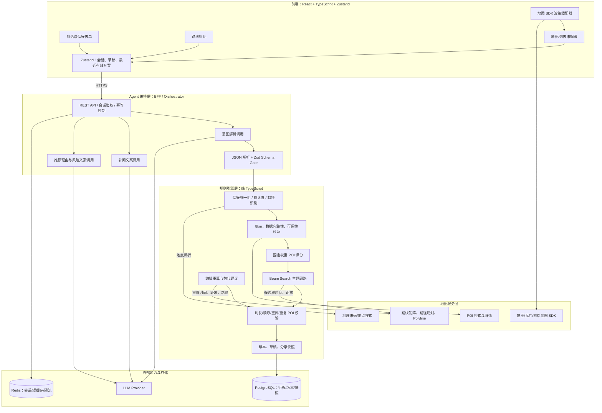
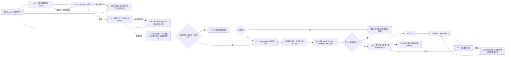
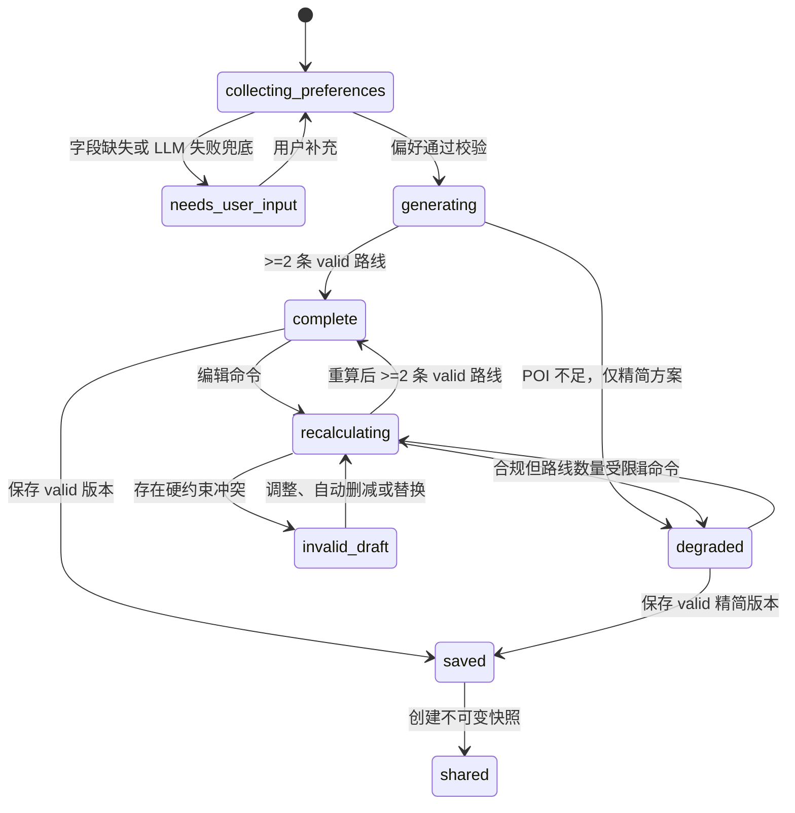

# TripBeam 技术架构

## 1. 项目概述

TripBeam 是面向陌生城市短时临时出行的单日旅行 Agent。用户以自然语言描述出发点、时间与偏好，系统经过必要的澄清后生成可比较、可编辑的路线，并支持保存和版本化分享。

MVP 的业务边界如下：

- 只支持单日短时行程，`availableMinutes` 必须在 30–240 分钟之间。
- 所有进入路线的 POI 必须位于出发点 8km 空间范围内，且具有完整坐标与建议停留时间。
- 正常方案至少有两条合规路线；候选不足时只能返回标记为 `degraded` 的精简方案，不能放宽时长和空间硬约束。
- 路线中的交通时间、距离、停留时间、顺序和合法性均由确定性 TypeScript 服务计算并校验。
- LLM 只能理解和表达：解析意图、生成补问、依据已验证事实编写推荐理由和风险文案。LLM 输出一律是不可信输入。

### 1.1 架构原则

1. **确定性优先。** 距离、时间、筛选、评分、路径搜索和约束判定不得由 LLM 生成、估算或裁决。
2. **后端为唯一事实源。** 前端的 Zustand 草稿仅用于交互；能展示为正式路线、保存和分享的数据必须来自后端校验结果。
3. **先校验，后使用。** Agent 返回结构化数据必须经过 JSON 解析和 Zod 校验；不合格数据不得进入 POI 检索和组路。
4. **编辑即失效重算。** 删除、替换、拖拽任一 POI 后，旧的距离、时长和风险即作废，直到新的规则计算完成。
5. **降级可用而非伪造。** 地图、LLM、POI 数据源失败时保留可验证的文字路线或补问流程，明确风险与状态，不编造实时性或路线事实。

### 1.2 可信数据边界

| 数据/结论 | 可信来源 | 使用规则 |
|---|---|---|
| 用户原始文本与表单选择 | 客户端请求 | 作为输入，需服务端校验与归一化 |
| LLM 意图 JSON | LLM | 仅可作为候选偏好；必须过 Zod 和业务校验 |
| POI 坐标、营业信息、基础评分 | POI 服务 | 缺坐标或停留时间即排除；营业未知仅可低优先级并带风险 |
| 路网距离、交通时间、几何路径 | 地图路线服务 | 只由地图服务/确定性适配器提供 |
| 路线时长、评分、合法性、版本 | 规则引擎 | 唯一可保存、分享和对外展示的正式结论 |
| 推荐理由、风险说明 | LLM 文案模块 | 只能引用规则引擎提供的事实、风险码和标签 |

## 2. 分层架构

建议采用 React + TypeScript 前端，TypeScript BFF/领域服务，外部 LLM、POI 与地图服务的适配器结构。领域对象、Zod Schema、风险码和约束配置放在共享包中，避免前后端类型漂移；运行时校验始终在服务端执行。



### 2.1 模块边界

| 模块 | 输入 | 输出 | 不负责 |
|---|---|---|---|
| 前端与 Zustand | 用户输入、服务端方案 | UI 状态、可恢复草稿、编辑命令 | 约束裁决、路线计算、分享快照生成 |
| Agent 编排层 | 原始文本、已验证事实、缺失字段 | 已校验偏好候选、补问、展示文案 | 距离/时长/路线计算和真实性判断 |
| 规则引擎 | 已验证偏好、POI、路网矩阵、编辑命令 | 合规路线、风险码、替代操作、版本状态 | 自由文本创作、臆测用户偏好 |
| 地图服务适配器 | 坐标、交通模式、POI 查询 | 地理编码、POI、时间/距离矩阵、几何路径 | 业务评分、硬约束放宽、版本管理 |
| 持久化与快照 | 已验证方案/草稿 | 草稿、正式版本、不可变分享快照 | 从未校验 LLM 内容构造路线 |

## 3. 核心数据流



### 3.1 生成与编辑状态机



`invalid_draft` 可以保留在本地草稿，但禁止正式保存和分享。地图不可用不是独立的路线状态：在方案 `risks` 中添加 `MAP_UNAVAILABLE`，仍可保持 `complete` 或 `degraded`。

## 4. LLM 与确定性代码职责对照

| 场景 | LLM 职责 | 纯 TS 规则函数职责 | 禁止事项 |
|---|---|---|---|
| 意图理解 | 从文本提取已表达的出发点、时间、兴趣、预算、出行偏好；未知则标记未知 | Zod 校验、范围校验、关键字段检查、默认值补全 | LLM 不可臆造坐标、时间、POI 或约束结论 |
| 补问 | 根据 `missingFields` 生成最多 3 项简短问题与选项文案 | 决定缺哪些字段、字段优先级和是否可生成路线 | LLM 不可判断“信息已经足够” |
| POI | 可生成已选 POI 的 UGC 摘要 | 检索、坐标完整性过滤、8km 过滤、可用性过滤、固定权重评分 | LLM 不可筛选、打分或声称实时排队 |
| 路线生成 | 不参与求解 | 调地图矩阵、Beam Search、交通/停留/缓冲累计、主题差异化 | LLM 不可计算距离、时长、路线合法性 |
| 约束校验 | 不参与 | 校验每个 POI 的空间范围、顺序、重复、总时长和状态 | LLM 不可输出 `valid`/`invalid` 裁决 |
| 推荐说明 | 将规则侧主题、POI 标签、得分说明转成 1–3 句理由 | 传入允许引用的事实，校验风险码和文案长度 | 不可写成实时营业、实时客流或预约承诺 |
| 编辑 | 不参与编辑结果计算 | 重新拉取受影响段矩阵，重算距离、时长、风险与替代集合 | 不可沿用旧路线指标 |
| 保存/分享 | 不参与 | 仅持久化 `constraintStatus=valid` 路线；创建不可变快照 | 不可由 LLM 或前端直接生成分享版本 |

## 5. 领域模型与规则引擎

### 5.1 关键对象

- `UserPreference`：归一化后的起点、开始时间、可用时长、兴趣和出行偏好；最大时长为 240 分钟。
- `PoiCandidate`：外部 POI 的内部标准化对象，含坐标、类别、建议停留、营业状态、标签、质量分与数据来源时间。
- `RouteDraft`：求解或编辑中的中间路线，可处于未校验或无效状态，不能分享。
- `Route`：通过 Zod 与跨字段业务校验后的路线；含确定性计算的总时长、距离、风险和约束结论。
- `ItineraryPlan`：一次规划返回的 1–3 条路线、状态与版本。正常 `complete` 至少两条；`degraded` 可只有一条。
- `ItineraryVersion` / `ShareSnapshot`：保存时产生的版本和分享时冻结的快照；分享后编辑不得回写快照。

### 5.2 确定性规则顺序

1. 验证/标准化偏好：坐标、ISO 时间、兴趣枚举、时长范围和交通偏好。
2. 过滤 POI：剔除无坐标、无建议停留时间、超出出发点 8km 的 POI；不可用 POI 剔除，营业未知可保留并标风险。
3. 计算固定可解释评分：`0.35*interest + 0.20*quality + 0.15*budgetFit + 0.15*mobilityFit + 0.10*availability + 0.05*queuePreferenceProxy`。权重由版本化配置维护并写入审计信息。
4. 构建候选段路网矩阵：以地图路线服务的距离和时长为准，对失败段标记不可用或使用明确的保守降级估计；估计不得伪装为地图导航。
5. 以主题配置运行 Beam Search：主题仅改变候选排序、奖励项和多样性惩罚，不改变 240 分钟与 8km 约束。
6. 对每条候选执行跨字段校验：POI 唯一、`sequence` 连续、每个 POI 在 8km 内、总时长由段交通 + 停留 + 缓冲重算且不超过 240 分钟。
7. 仅将 `valid` 的路线交给文案模块和持久化模块；风险码由规则引擎产生，LLM 只可翻译。

## 6. API 调用清单

所有 API 使用 UTF-8 JSON、ISO 8601 含时区时间；写操作携带 `Idempotency-Key`。所有响应以 `requestId` 关联日志和链路追踪。路线、保存和分享接口必须由服务端再次执行运行时校验，不能信任客户端传来的汇总数值。

| API | 方法 | 调用方 | 主要职责 | 关键规则 |
|---|---|---|---|---|
| `/v1/conversations/{id}/messages` | `POST` | 前端 | 提交自然语言与补问回答，返回偏好、缺项或补问 | LLM 意图输出经 Zod；最多一次修复重试 |
| `/v1/locations/resolve` | `POST` | 前端/编排层 | 将文本地点或地图选点规范化为 `origin` | 地理编码结果必须确认坐标与来源 |
| `/v1/itineraries/generate` | `POST` | 前端 | 基于完整偏好生成路线方案 | 规则引擎完成过滤、Beam Search 与约束校验 |
| `/v1/itineraries/{id}` | `GET` | 前端 | 获取当前方案与版本状态 | 只返回已验证的路线指标 |
| `/v1/itineraries/{id}/draft/edits` | `POST` | 前端 | 删除、替换、排序等编辑命令 | 命令式输入；后端重算，不能传入总时长/距离覆盖结果 |
| `/v1/itineraries/{id}/alternatives` | `GET` | 前端 | 获取附近/同类可替换 POI | 仍经过 8km、可用性与数据完整性过滤 |
| `/v1/itineraries/{id}/save` | `POST` | 前端 | 保存有效路线版本 | 仅接受 `constraintStatus=valid` 的服务端草稿 |
| `/v1/itineraries/{id}/share` | `POST` | 前端 | 创建版本化、不可变分享快照 | 离线失败；只允许已保存有效版本 |
| `/v1/shares/{token}` | `GET` | 分享页 | 读取冻结的路线快照 | 不回读可变草稿 |
| `/v1/maps/route-preview` | `POST` | 前端（可选） | 获取渲染所需 Polyline/标记 | 失败仅触发地图降级，不影响路线业务操作 |

### 6.1 编辑命令示例

编辑接口采用显式命令，防止客户端提交伪造的路线计算结果：

```json
{
  "baseVersion": 7,
  "operation": "reorder",
  "poiIds": ["poi-a", "poi-c", "poi-b"],
  "clientDraftId": "draft-uuid"
}
```

服务端忽略客户端提供的 `totalDurationMinutes`、`totalDistanceMeters`、`constraintStatus` 和风险数组，重新计算后返回新的草稿版本、超限明细和可行动作。

## 7. 外部依赖清单

| 依赖类别 | 推荐抽象接口 | 用途 | 降级与约束 |
|---|---|---|---|
| LLM Provider | `IntentParser`、`ClarificationWriter`、`RouteCopyWriter` | 意图 JSON、补问、理由和风险文案 | 超时/两次非法输出后进入规则化补问；不能提供数值结论 |
| 地理编码服务 | `Geocoder` | 文本起点解析、地点搜索 | 无法解析时要求用户地图选点或手填地点 |
| POI 数据源 | `PoiRepository` | POI、类别、坐标、营业、标签、基础质量 | 数据不完整的 POI 不参与组路；缓存并记录 `dataUpdatedAt` |
| 路线/矩阵服务 | `RoutingProvider` | 分段距离、时长、路线几何 | 业务路径失效时不能用 LLM 替代；地图预览可独立失败 |
| 地图 SDK/瓦片 | `MapRenderer` | 客户端底图、Marker、Polyline | 失败时退化为文字路线，不阻断核心操作 |
| PostgreSQL | `ItineraryRepository` | 行程、版本、快照、审计 | 保存走事务；分享快照不可变 |
| Redis | `SessionStore`、`RateLimiter`、`Cache` | 会话、限流、地理/POI/矩阵短缓存 | 缓存不可用时回源并限流，不返回陈旧为实时结果 |
| 可观测性 | OpenTelemetry + 日志/指标平台 | `requestId`、耗时、外部调用、规则拒绝原因 | 日志脱敏，不记录精确位置的无授权长期明文 |

外部供应商由环境配置决定；业务域只依赖以上接口，便于替换地图或模型供应商，也便于以 mock 进行确定性测试。

## 8. 超时、异常与降级策略

### 8.1 超时预算与重试

| 环节 | 目标超时 | 重试 | 失败后的行为 |
|---|---:|---:|---|
| LLM 意图解析 | 3s | 最多一次 JSON 修复重试 | 转规则化提取与表单补问，不展示未校验结果 |
| LLM 文案生成 | 2s | 0–1 次（仅瞬态错误） | 返回规则模板文案与风险码，路线仍可使用 |
| 地理编码 | 2s | 1 次 | 要求地点搜索、手填或地图选点 |
| POI 检索 | 3s | 1 次 | 使用未过期缓存；无可用数据则进入 POI 不足流程 |
| 路线矩阵/路径规划 | 3s | 1 次、带熔断 | 无可靠段数据时不产生正式路线；已有路线地图预览可降级为文字列表 |
| 整体首次生成 | 8s | 由编排层的剩余预算控制 | 返回明确的处理中/可重试状态，不保存半成品 |
| 编辑重算 | 2s | 0–1 次 | 草稿保留为 `recalculating`；超时后禁止保存/分享，可恢复上版 |
| 保存/分享 | 3s | 客户端使用同一幂等键重试 | 保留草稿与成功前状态，分享不创建半成品链接 |

### 8.2 异常处置

| 场景 | 服务端处理 | 客户端可用能力 |
|---|---|---|
| LLM 非法 JSON/字段越界 | 记录结构化校验错误；至多一次受限修复；随后转补问 | 看见“需要确认几项偏好”，输入不丢失 |
| 偏好关键字段缺失 | 返回 `needs_user_input` 与 `missingFields` | 继续对话/表单补齐，不进入检索 |
| POI 不足 | 按“类别阈值 → 评分阈值 → 营业未知”放宽软约束，保留审计记录 | 调整偏好/起点/停留时间，或接受带 `ROUTE_COUNT_LIMITED` 的精简方案 |
| 路线编辑超限 | 返回 `invalid_draft`、超出分钟数/违反 POI 和替代候选 | 草稿可见；保存/分享禁用；可自动删减、附近替换、恢复有效版本 |
| 地图 SDK、瓦片或 Polyline 失败 | 给方案加 `MAP_UNAVAILABLE`；不修改路线校验事实 | 路线卡、顺序、地址、编辑、保存、分享继续可用 |
| POI/地图服务暂不可用 | 熔断、缓存回退、错误分类 | 已有有效路线可阅读和编辑；无法可靠重算时明确阻止保存 |
| 保存或分享失败 | 事务回滚或幂等返回；不生成孤儿快照 | Zustand 保留本地草稿和最近有效方案，提供重试 |

### 8.3 风险码策略

规则引擎生成 `OPENING_HOURS_UNCERTAIN`、`MAP_UNAVAILABLE`、`POI_DATA_PARTIAL`、`ROUTE_TIME_TIGHT`、`PREFERENCE_RELAXED`、`ROUTE_COUNT_LIMITED`、`EDIT_EXCEEDS_LIMIT` 等稳定风险码。API 传递码、等级、作用域和事实上下文；LLM/前端只能进行可读化展示，不能更改等级或移除风险。

## 9. 性能、稳定性与可观测性目标

| 指标 | 目标 | 测量口径 |
|---|---:|---|
| 冷启动核心可交互 | ≤ 1.5s | 首次打开至输入与最近方案可操作；不等待地图 |
| 热启动中位数 | ≤ 0.3s | 静态资源和最近状态已缓存时恢复到输入界面 |
| 首次路线生成 | 正常网络 ≤ 8s | 补问完成至首个已校验方案可渲染，含外部检索与路线计算 |
| 编辑重算 | ≤ 2s | 编辑提交至返回最新 valid/invalid 校验结果 |
| 地图故障下核心文字路线能力 | 100% | 地图失败不阻塞选择、编辑、保存、分享 |
| 正常完整方案数量 | ≥ 2 条 | `complete` 状态的合规路线数；不足必须转 `degraded` |
| 硬约束违规率 | 0 | 保存/分享快照中出现超过 240 分钟、超 8km、重复/乱序 POI 的比例 |

必须记录并告警的指标包括：LLM Schema 失败率、补问转化率、POI 过滤各原因数量、Beam Search 候选/有效路线数量、编辑超限率、外部服务 p95 延迟与错误率、地图降级率、保存/分享幂等冲突率。每次路线生成和编辑重算使用同一 `traceId` 贯穿客户端、BFF、规则引擎和外部适配器；审计记录中保留规则版本、评分配置版本、数据源版本和约束拒绝原因。

## 10. 安全与一致性要求

- 将 API 密钥、地图和 LLM 调用保留在服务端；浏览器只使用受限地图 SDK 凭据。
- 对位置、原始文本和分享令牌进行最小化存储与日志脱敏；分享 token 使用不可预测随机值并支持撤销。
- 所有写入使用乐观并发控制：编辑携带 `baseVersion`，版本不一致时返回冲突与最新有效版本，禁止静默覆盖。
- 保存和分享事务只引用经过校验的行程版本；分享读取不可变快照，后续草稿编辑不得影响已发出的链接。
- Zod Schema 负责边界形状与基础范围，领域规则负责跨字段约束；两者都必须在服务端运行，前端校验只提升体验，不能替代服务端裁决。
