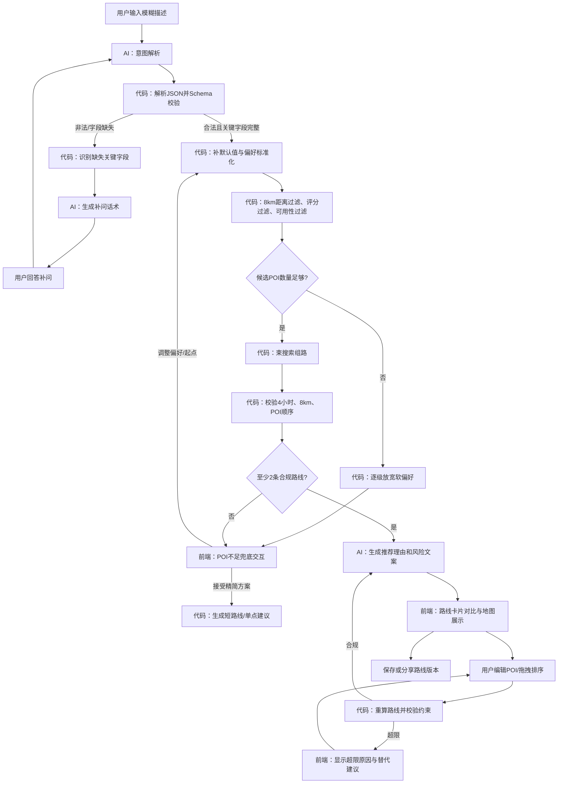

# TripBeam：短时临时出行规划 Agent PRD

## 1. 概述

### 1.1 产品目标

为在陌生城市、只有模糊偏好和有限时间的临时出行用户，快速生成可执行、可比较、可编辑的短时单日出行路线。用户从一句自然语言描述出发，经补问澄清后获得至少 2 条路线，并可在地图上查看、编辑、保存和分享。

### 1.2 MVP 范围

- 仅支持单日、短时临时出行；单次行程最大时长为 **4 小时**。
- 所有 POI 必须位于可用出发点/规划中心的 **8km** 空间范围内。
- 至少输出 2 条满足硬约束的对比路线；不足时采用文档定义的兜底交互。
- 支持 POI 删除、替换、排序拖拽、地图查看、保存和分享。
- 不接入实时排队/客流数据；用户对“少排队”的表达仅转换为 POI 偏好权重。

### 1.3 非目标

- 多日、多城市、住宿、票务预订或餐厅预约。
- 实时公共交通调度、实时拥堵或实时排队承诺。
- 多人协同编辑和社交内容生产。

### 1.4 架构分工与不可跨越边界

| 层级 | 职责 | 禁止承担的职责 |
|---|---|---|
| 【AI Agent 逻辑层】 | 自然语言意图解析、补问话术生成、POI UGC 摘要、路线推荐理由、风险提示文案 | 距离计算、时长累加、POI 分数过滤、路线求解、约束判定、Schema 可信性判定 |
| 【确定性规则程序层】 | Schema 校验、默认值补全、距离过滤、时长累加、POI 评分过滤、营业可用性过滤、束搜索路径生成、硬约束校验、路线重算 | 生成开放式自然语言，推断用户未表达的偏好 |
| 前端（React + TypeScript + Zustand + 地图 API） | 输入与补问交互、路线对比、地图展示、编辑状态、保存分享、降级界面 | 以 UI 状态替代后端约束校验 |

**原则：**LLM 产出的任何结构化内容均视为不可信输入。必须先经 JSON 解析和 Schema 校验，再由确定性程序生成或验证可展示路线；只有确定性程序输出的路线可保存、分享和在地图中展示。

---

## 2. 业务流程图



---

## 3. 模块需求

### 3.1 模糊需求输入与偏好澄清

**目标：**将自由文本转换为可执行的 `UserPreference`，且在路线生成前补齐必要字段。

| 编号 | 需求 | 验收标准 |
|---|---|---|
| RQ-01 | 提供自由文本输入框，支持如“下午 4 小时，想吃本地菜、拍照，不想太累”的描述。 | 用户可提交非结构化文本并看到解析/补问状态。 |
| RQ-02 | AI 仅提取意图：出发点、开始时间、可用时长、兴趣、预算、步行偏好、交通偏好、同行方式、排队偏好。 | AI 输出可被解析为 JSON；不包含路线、距离或硬约束裁决。 |
| RQ-03 | 代码层判断必要字段是否齐全：`origin`、`startTime`、`availableMinutes`、至少一项兴趣或体验偏好。 | 缺失时不得进入 POI 检索和组路。 |
| RQ-04 | AI 基于代码返回的 `missingFields` 生成简短补问话术；前端以单选、标签和可选文本输入承接。 | 每轮最多询问 3 项；用户回答后可合并到现有偏好。 |
| RQ-05 | 当用户填入超过 240 分钟时，代码层拒绝该值并提示产品上限。 | 用户需缩短时间后才能继续。 |

**关键字段优先级：**出发点 > 可用时间 > 开始时间 > 偏好。若用户拒绝定位，必须支持输入酒店、地标、商圈或地图选点。

### 3.2 POI 检索、过滤与评分（确定性规则程序层）

| 编号 | 需求 | 验收标准 |
|---|---|---|
| RQ-06 | 从 POI 数据源获取候选 POI；每项含坐标、类别、建议停留时间、营业信息、基础评分和标签。 | 数据缺失坐标或建议停留时间的 POI 不参与组路。 |
| RQ-07 | 以出发点为中心过滤直线距离超过 8km 的 POI。 | 任何输出路线不得包含超过 8km 范围的 POI。 |
| RQ-08 | 依据确定性权重计算 POI 分数：兴趣匹配、预算匹配、步行适配、POI 质量、可用性、少排队偏好代理分。 | 可在服务端记录每项得分来源，便于调试。 |
| RQ-09 | “少排队”只影响代理分（例如容量、类别、时段经验分），不得显示为实时排队结论。 | 前端不出现“当前无需排队”等承诺性文案。 |
| RQ-10 | 营业状态不可确认的 POI 可作为低优先级候选，但必须向风险模块标记。 | 路线卡中可看到相应风险提示。 |

建议评分示例：`score = 0.35*interest + 0.20*quality + 0.15*budgetFit + 0.15*mobilityFit + 0.10*availability + 0.05*queuePreferenceProxy`。权重配置在代码侧维护，非 LLM 推断。

### 3.3 多路线生成与校验（确定性规则程序层）

| 编号 | 需求 | 验收标准 |
|---|---|---|
| RQ-11 | 使用束搜索生成具有差异化主题的候选路径，如美食优先、拍照优先、轻松漫游。 | 正常情况下返回至少 2 条有效路线。 |
| RQ-12 | 累加交通时间、POI 停留时间与预留缓冲时间，校验总时长不超过 240 分钟。 | `totalDurationMinutes <= 240`。 |
| RQ-13 | 路线中的每个 POI 均需通过 8km、可用性和数据完整性校验。 | 校验不通过的路线不可返回。 |
| RQ-14 | 每条路线必须包含推荐理由依据、风险标签、约束校验结果和版本号。 | 保存与分享调用仅接受校验状态为 `valid` 的方案。 |
| RQ-15 | 用户编辑后重新组路或重算，不允许沿用编辑前的时间、距离和风险结果。 | 删除、替换、排序操作后 2 秒内更新校验结果。 |

### 3.4 路线对比与地图展示（前端）

| 编号 | 需求 | 验收标准 |
|---|---|---|
| RQ-16 | 以卡片并列展示至少 2 条路线的主题、总时长、总距离、POI 数量、步行强度、推荐理由和风险摘要。 | 用户无需进入详情即可比较关键差异。 |
| RQ-17 | 地图展示路线折线、顺序编号和 POI 标记；选择路线卡时同步高亮。 | 卡片、地图和详情的路线 ID 保持一致。 |
| RQ-18 | 地图加载失败时，页面仍展示路线列表、POI 顺序、文字方向、时间与距离。 | 地图失败不阻塞选择、编辑、保存或分享。 |

### 3.5 路线编辑、保存与分享

| 编号 | 需求 | 验收标准 |
|---|---|---|
| RQ-19 | 支持删除 POI、替换同类/附近 POI、拖拽调整停靠顺序。 | 任一编辑操作产生本地草稿并触发重算。 |
| RQ-20 | 若编辑超出时长或空间约束，展示具体超限原因及“自动删减”“替换附近 POI”“恢复上版”操作。 | 不允许将无效路线保存为正式版本。 |
| RQ-21 | 支持保存路线草稿和创建版本化分享链接。 | 分享链接指向创建时的路线快照，后续编辑不影响已分享内容。 |

### 3.6 AI 文案模块

| 编号 | 输入 | 输出 | 约束 |
|---|---|---|---|
| AI-01 意图解析 | 原始描述、补问回答 | `UserPreference` 候选 JSON | 只能提取或标记未知，不能编造坐标、POI 或时长。 |
| AI-02 补问生成 | `missingFields`、现有偏好 | 补问文案与选项文案 | 问题不超过 3 个，问题本身不做逻辑判断。 |
| AI-03 推荐理由 | 已校验路线、各 POI 标签与规则侧得分说明 | 1–3 句路线理由 | 必须引用传入事实；不可称为实时信息。 |
| AI-04 风险文案 | 规则侧风险码与上下文 | 用户可读风险文案 | 不改变风险级别和风险码。 |

---

## 4. 数据 Schema

### 4.1 通用约定

- 所有 API 使用 UTF-8 JSON，时间使用 ISO 8601 带时区格式。
- `id` 为 UUID 或可追踪的稳定字符串。
- `additionalProperties: false` 用于 Agent 与服务端边界上的关键对象。
- 本节为接口和校验实现的规范来源；前后端可据此生成 TypeScript 类型与运行时校验器。

### 4.2 用户偏好 `UserPreference`

```json
{
  "$schema": "https://json-schema.org/draft/2020-12/schema",
  "$id": "https://tripbeam.example/schemas/user-preference.json",
  "title": "UserPreference",
  "type": "object",
  "additionalProperties": false,
  "required": ["origin", "startTime", "availableMinutes", "interestTags", "mobility"],
  "properties": {
    "origin": {
      "type": "object",
      "additionalProperties": false,
      "required": ["label", "latitude", "longitude", "source"],
      "properties": {
        "label": {"type": "string", "minLength": 1, "maxLength": 120},
        "latitude": {"type": "number", "minimum": -90, "maximum": 90},
        "longitude": {"type": "number", "minimum": -180, "maximum": 180},
        "source": {"type": "string", "enum": ["gps", "search", "map_pin", "manual"]}
      }
    },
    "startTime": {"type": "string", "format": "date-time"},
    "availableMinutes": {"type": "integer", "minimum": 30, "maximum": 240},
    "interestTags": {
      "type": "array",
      "minItems": 1,
      "maxItems": 6,
      "items": {"type": "string", "enum": ["food", "coffee", "culture", "photo", "shopping", "nature", "nightlife", "relax"]},
      "uniqueItems": true
    },
    "budget": {"type": "string", "enum": ["low", "medium", "high", "unspecified"], "default": "unspecified"},
    "mobility": {"type": "string", "enum": ["easy_walk", "normal_walk", "transit_allowed", "taxi_allowed"]},
    "companions": {"type": "string", "enum": ["solo", "pair", "family", "friends", "unspecified"], "default": "unspecified"},
    "queuePreference": {"type": "string", "enum": ["avoid", "neutral", "accept"], "default": "neutral"},
    "mustIncludePoiIds": {"type": "array", "items": {"type": "string"}, "maxItems": 3, "uniqueItems": true},
    "rawInput": {"type": "string", "maxLength": 1000}
  }
}
```

### 4.3 POI 项 `PoiItem`

```json
{
  "$schema": "https://json-schema.org/draft/2020-12/schema",
  "$id": "https://tripbeam.example/schemas/poi-item.json",
  "title": "PoiItem",
  "type": "object",
  "additionalProperties": false,
  "required": ["id", "name", "category", "location", "stayMinutes", "score", "sequence"],
  "properties": {
    "id": {"type": "string", "minLength": 1},
    "name": {"type": "string", "minLength": 1, "maxLength": 160},
    "category": {"type": "string", "enum": ["restaurant", "cafe", "attraction", "museum", "park", "market", "shop", "viewpoint", "other"]},
    "location": {
      "type": "object",
      "additionalProperties": false,
      "required": ["latitude", "longitude", "address"],
      "properties": {
        "latitude": {"type": "number", "minimum": -90, "maximum": 90},
        "longitude": {"type": "number", "minimum": -180, "maximum": 180},
        "address": {"type": "string", "maxLength": 240}
      }
    },
    "stayMinutes": {"type": "integer", "minimum": 10, "maximum": 180},
    "travelFromPreviousMinutes": {"type": "integer", "minimum": 0, "maximum": 120},
    "distanceFromPreviousMeters": {"type": "integer", "minimum": 0, "maximum": 20000},
    "score": {"type": "number", "minimum": 0, "maximum": 100},
    "scoreBreakdown": {
      "type": "object",
      "additionalProperties": false,
      "properties": {
        "interest": {"type": "number", "minimum": 0, "maximum": 100},
        "quality": {"type": "number", "minimum": 0, "maximum": 100},
        "budgetFit": {"type": "number", "minimum": 0, "maximum": 100},
        "mobilityFit": {"type": "number", "minimum": 0, "maximum": 100},
        "availability": {"type": "number", "minimum": 0, "maximum": 100},
        "queuePreferenceProxy": {"type": "number", "minimum": 0, "maximum": 100}
      }
    },
    "tags": {"type": "array", "items": {"type": "string"}, "maxItems": 10, "uniqueItems": true},
    "ugcSummary": {"type": "string", "maxLength": 300},
    "openStatus": {"type": "string", "enum": ["open", "closed", "unknown", "may_close"]},
    "sequence": {"type": "integer", "minimum": 1}
  }
}
```

### 4.4 风险提示 `RiskNotice`

```json
{
  "$schema": "https://json-schema.org/draft/2020-12/schema",
  "$id": "https://tripbeam.example/schemas/risk-notice.json",
  "title": "RiskNotice",
  "type": "object",
  "additionalProperties": false,
  "required": ["code", "level", "scope", "message"],
  "properties": {
    "code": {"type": "string", "enum": ["OPENING_HOURS_UNCERTAIN", "MAP_UNAVAILABLE", "POI_DATA_PARTIAL", "ROUTE_TIME_TIGHT", "PREFERENCE_RELAXED", "ROUTE_COUNT_LIMITED", "EDIT_EXCEEDS_LIMIT"]},
    "level": {"type": "string", "enum": ["info", "warning", "critical"]},
    "scope": {"type": "string", "enum": ["itinerary", "route", "poi", "system"]},
    "poiId": {"type": "string"},
    "message": {"type": "string", "minLength": 1, "maxLength": 240},
    "actionLabel": {"type": "string", "maxLength": 40}
  }
}
```

### 4.5 单路线 `Route`

```json
{
  "$schema": "https://json-schema.org/draft/2020-12/schema",
  "$id": "https://tripbeam.example/schemas/route.json",
  "title": "Route",
  "type": "object",
  "additionalProperties": false,
  "required": ["id", "theme", "pois", "totalDurationMinutes", "totalDistanceMeters", "constraintStatus", "recommendationReason", "risks"],
  "properties": {
    "id": {"type": "string", "minLength": 1},
    "theme": {"type": "string", "enum": ["food_first", "photo_first", "easy_walk", "balanced"]},
    "title": {"type": "string", "maxLength": 80},
    "pois": {"type": "array", "minItems": 1, "maxItems": 8, "items": {"$ref": "poi-item.json"}},
    "totalDurationMinutes": {"type": "integer", "minimum": 1, "maximum": 240},
    "totalDistanceMeters": {"type": "integer", "minimum": 0, "maximum": 50000},
    "walkingIntensity": {"type": "string", "enum": ["low", "medium", "high"]},
    "constraintStatus": {"type": "string", "enum": ["valid", "invalid"]},
    "constraintDetails": {
      "type": "object",
      "additionalProperties": false,
      "required": ["withinTimeLimit", "withinSpatialLimit"],
      "properties": {
        "withinTimeLimit": {"type": "boolean"},
        "withinSpatialLimit": {"type": "boolean"},
        "violations": {"type": "array", "items": {"type": "string"}, "maxItems": 5}
      }
    },
    "recommendationReason": {"type": "string", "minLength": 1, "maxLength": 500},
    "risks": {"type": "array", "items": {"$ref": "risk-notice.json"}, "maxItems": 8}
  }
}
```

### 4.6 行程方案 `ItineraryPlan`

```json
{
  "$schema": "https://json-schema.org/draft/2020-12/schema",
  "$id": "https://tripbeam.example/schemas/itinerary-plan.json",
  "title": "ItineraryPlan",
  "type": "object",
  "additionalProperties": false,
  "required": ["id", "version", "preference", "routes", "status", "generatedAt", "risks"],
  "properties": {
    "id": {"type": "string", "minLength": 1},
    "version": {"type": "integer", "minimum": 1},
    "preference": {"$ref": "user-preference.json"},
    "routes": {"type": "array", "minItems": 1, "maxItems": 3, "items": {"$ref": "route.json"}},
    "status": {"type": "string", "enum": ["complete", "degraded", "needs_user_input"]},
    "generatedAt": {"type": "string", "format": "date-time"},
    "risks": {"type": "array", "items": {"$ref": "risk-notice.json"}, "maxItems": 8},
    "shareToken": {"type": "string", "minLength": 8, "maxLength": 128}
  }
}
```

**业务校验补充：**JSON Schema 无法表达所有跨字段约束。因此必须额外在代码中验证：路线 `constraintStatus` 为 `valid`、每个 POI 到出发点不超过 8km、POI `sequence` 连续且唯一、总时长等于构成项累加且不超过 240 分钟。`routes` 在正常 `complete` 状态下最少为 2 条；仅降级状态允许 1 条。

---

## 5. 异常处理与降级方案

### 5.1 地图 API 失败

| 触发条件 | 前端行为 | 服务端/状态行为 |
|---|---|---|
| 地图 SDK 初始化失败、请求超时或瓦片加载失败 | 显示“地图暂不可用”内嵌状态和重试按钮；保留路线卡、POI 顺序列表、地址、总时长和距离 | 将方案标为 `degraded` 并加入 `MAP_UNAVAILABLE` 风险；不得阻塞编辑、保存和分享 |
| 地图路径绘制失败但底图可用 | 以编号标记 POI，改用列表展示 POI 顺序 | 使用确定性计算的距离/时间作为文字信息，不伪造地图路径 |

### 5.2 LLM 返回非法 JSON

| 阶段 | 处理 |
|---|---|
| 第一次解析失败或 Schema 失败 | 将校验错误（字段路径、期望类型、缺失字段）回传给 LLM，执行一次仅限 JSON 修正重试。 |
| 第二次仍失败或 LLM 超时 | 进入规则化兜底：从用户原始文本提取可识别的时间/标签；其余字段由前端补问收集。不得使用未校验 LLM 结果。 |
| 用户侧提示 | 显示“我们需要确认几项出行偏好”，转入补问界面；不展示模型异常技术细节。 |

### 5.3 POI 数量不足

**触发：**完成 8km 和基础可用性过滤后，不足以组成至少 2 条合规路线。

**代码侧放宽顺序：**

1. 放宽类别/主题匹配阈值；
2. 放宽评分阈值；
3. 允许营业状态为 `unknown` 的 POI，并附营业风险；
4. 保持 4 小时、8km、坐标完整性等硬约束不变。

**前端兜底交互：**

- 优先展示“可调整偏好”“更换出发点”“缩短期望停留时间”三个操作。
- 用户选择继续时，可展示 1 条精简路线或单点建议，方案状态为 `degraded`，并显示 `ROUTE_COUNT_LIMITED` / `PREFERENCE_RELAXED` 风险。
- 不得把一条路线伪装成多路线对比，也不得为凑足数量放宽硬约束。

### 5.4 编辑后的约束冲突

- 编辑触发后，前端先显示“正在重新校验”，后端重新计算距离、交通时间、停留时间和风险。
- 若不合规，草稿可暂存但不可正式保存/分享；展示超出分钟数或违反的 POI。
- 提供自动删减、附近替换、恢复上一合规版本；任何自动调整须由用户确认后覆盖草稿。

### 5.5 网络和保存失败

- Zustand 持久化保存当前编辑草稿及最近一次有效方案。
- 保存或分享失败时显示可重试状态，不丢失当前编辑结果。
- 分享只基于服务端已验证的方案快照创建；离线状态不可创建分享链接。

---

## 6. 验证方案

### 6.1 单元测试

| 范围 | 必测项 |
|---|---|
| Schema 校验 | 合法对象、缺失必要字段、额外字段、错误枚举、非法坐标、`availableMinutes > 240`。 |
| POI 过滤 | 超过 8km 的 POI 被移除；坐标缺失的 POI 被移除；软偏好可逐级放宽。 |
| 路线求解 | 生成路线总时长不超过 240 分钟；顺序连续；无重复 POI；不同主题路线具有差异。 |
| 编辑重算 | 删除、替换、拖拽后时间/距离重算；超限路线被标为 `invalid`。 |
| 降级 | 地图失败、非法 LLM JSON、POI 不足时产生预期状态和风险码。 |

### 6.2 集成测试

1. 输入“下午四小时，想吃本地菜、拍照，不想太累”后，补齐起点和开始时间，得到至少 2 条合规路线。
2. 模拟 LLM 返回非 JSON、错误字段类型和未知字段，确认只会进入一次修正重试，随后转到表单补问。
3. 模拟地图 API 超时，确认路线卡、编辑、保存和分享仍可执行。
4. 模拟候选 POI 不足，确认系统不突破 4 小时和 8km，并向用户提供调整选项。
5. 编辑路线使总时长超过 240 分钟，确认不能保存/分享，且可恢复有效版本。
6. 分享后修改原路线，确认打开旧分享链接仍显示创建时快照。

### 6.3 性能与稳定性验收

| 指标 | 目标 | 测量口径 |
|---|---|---|
| 冷启动 | ≤ 1.5s | 从首次打开 Web 应用至核心输入界面可交互；不以地图完整加载作为阻塞条件。 |
| 热启动中位数 | ≤ 0.3s | 已缓存静态资源和最近状态时，从恢复应用至输入界面可交互的中位数。 |
| 首次路线生成 | 正常网络目标 ≤ 8s | 从补问完成至首个已校验路线方案渲染。 |
| 路线编辑重算 | ≤ 2s | 从用户提交删除、替换、拖拽操作至显示最新有效/无效校验结果。 |
| 地图故障可用性 | 100% 保留核心文字路线能力 | 地图失败时，路线选择、编辑、保存、分享不可被阻断。 |

### 6.4 发布验收门槛

- Must 流程闭环：模糊描述 → 补问 → 至少 2 条路线 → 地图对比 → 编辑 → 保存/分享。
- 任一最终输出路线均经代码层 Schema 与硬约束校验。
- 地图 API 失败、LLM 非法 JSON、POI 不足三类降级流程均通过集成测试。
- 冷启动和热启动中位数满足本 PRD 性能指标。
