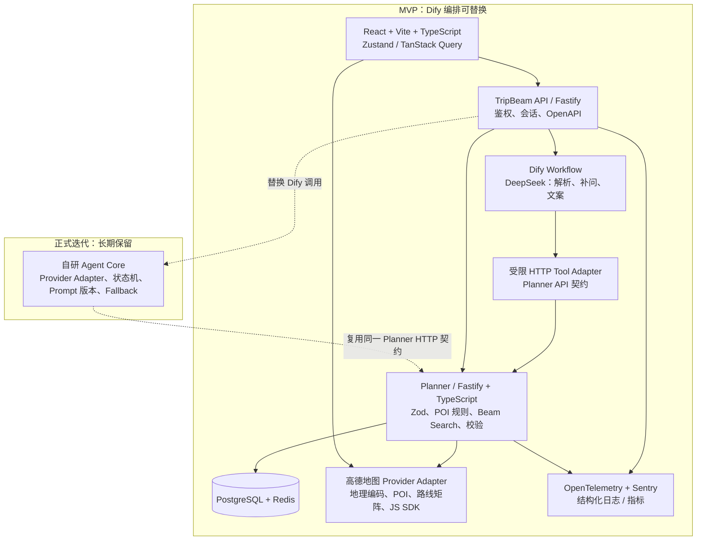

# TripBeam 技术选型方案

> 评审对象：短时临时出行规划 Agent MVP 及其正式迭代目标架构。  
> 结论先行：MVP 采用 **独立 React 前端 + Dify Workflow + DeepSeek + 自研 TypeScript Planner 服务**；Dify 仅承载可替换的 LLM 编排，不承载路线事实、会话事实或业务规则。正式迭代以 **自研 Agent Core** 替换 Dify，前端、Planner、API 契约、存储和地图适配器保持复用。

## 1. 项目约束与选型原则

### 1.1 架构约束（来自 arch.md）

| 约束 | 对技术选型的直接影响 |
|---|---|
| 仅支持单日短时行程；总时长不超过 240 分钟 | Planner 必须是同步、低延迟的确定性服务；无须在 MVP 引入工作流引擎或异步任务编排框架。 |
| 任一 POI 与出发点空间距离不超过 8km | 必须选用可返回坐标和路网时间/距离的地图供应商；Planner 内必须实现独立的地理距离过滤，不能以地图前端显示替代。 |
| 正常返回至少两条合规路线；不足时显式降级 | Beam Search、候选多样性、约束校验和风险码必须位于自研服务，而不是 Dify 节点或 Prompt。 |
| LLM 只做意图、补问、理由和风险文案 | DeepSeek/Dify 输出被视为不可信输入；必须经过 JSON 解析、Zod 校验和规则引擎二次判定。 |
| 禁止 LLM 计算距离、时长、路线合法性 | 不选择“LLM Tool Calling 直接调用地图并决定路线”的实现；地图与 Planner 只由代码调用。 |
| 地图失败不影响路线文字能力、编辑、保存和分享 | 地图 SDK 与地图几何必须可独立降级；保存的路线事实存储在 PostgreSQL，不能依赖地图页面状态。 |
| 删除、替换、拖拽后 2 秒内重算 | Planner 要保持无状态、可横向扩展；使用路由矩阵短缓存与限制候选规模，而非后台慢任务。 |
| 分享链接指向不可变快照 | 需要关系型事务、版本号和乐观并发控制；不以 Dify 会话历史或前端 localStorage 作为正式数据源。 |

### 1.2 选型原则

1. **MVP 快速验证。** 使用 Dify 可视化 Workflow 验证 Prompt、补问和文案效果，但前端不接入 Dify 原生聊天页，业务 API 保持自有。
2. **低迁移成本。** 所有可长期保留的业务边界——OpenAPI、Zod Schema、Planner、数据库、地图 Provider Adapter、事件模型——从第一天就归自研代码所有。
3. **边界清晰。** Dify 只能通过受限 HTTP 工具调用 Planner；工具接口不暴露“计算合法性”的可选口径，也不允许模型传入总距离、总时长和 `valid` 状态。
4. **优先 TypeScript/Python 生态。** 路线规则、Web API、前端采用 TypeScript 以共享 Zod 类型和枚举；仅在评测/离线数据清洗、实验性算法需要时使用 Python，不拆分 MVP 在线 Planner。
5. **兼容 Dify HTTP 调用。** Planner 以稳定、无会话依赖的 JSON HTTP 接口暴露，并使用 API Key/HMAC、超时、幂等和版本化契约。
6. **可观测与可调试。** 每次请求必须携带 `requestId`/`traceId`、规则版本、评分配置版本、外部 Provider 耗时与拒绝原因；Prompt 调试不能替代业务审计。
7. **避免过度工程。** MVP 不引入 Kubernetes、服务网格、消息队列、向量数据库、图数据库、复杂 Agent 框架或多语言微服务网格；这些均不能解决当前 4 小时/8km 约束问题。

### 1.3 非功能性需求约束

| 维度 | MVP 约束与门槛 | 正式迭代方向 | 对选型的含义 |
|---|---|---|---|
| 首次生成 | 正常网络 ≤ 8s | 持续监控 p95，按城市/Provider 分析 | Dify、LLM、POI、路线矩阵均需独立超时；Planner 不等待文案才产出已验证路线。 |
| 编辑重算 | ≤ 2s | p95 ≤ 2s，容量压测后扩容 | 选择 Fastify + Redis 短缓存；限制候选 POI、路线数量与 Beam 宽度。 |
| 核心可用性 | 地图失败仍可编辑、保存、分享 | Provider 熔断与多供应商策略 | 前端地图与后端路线事实解耦。 |
| 并发 | MVP 以“目标城市、候选数、地图配额”做压测基线；上线前至少验证 20 个并发生成请求和 50 个并发编辑重算请求 | 按实际峰值与 p95 规划水平扩容，不预设不可信 DAU | 无状态 API/Planner、PostgreSQL + Redis、Provider 限流器优于单机锁或 Dify 会话状态。 |
| 开发效率 | 1 个 TypeScript 代码库、少量可部署单元 | 可按读写/评测需求拆分 | 不将业务逻辑分散到 Dify DSL、前端和多个语言服务。 |
| 部署复杂度 | Docker Compose 可完整运行开发/测试环境 | 容器平台或托管服务可渐进接入 | Dify 是独立基础设施；应用服务无需与其同仓同生命周期。 |
| 数据一致性 | 保存/分享只接受服务端 `valid` 版本 | 审计、撤销、保留策略 | PostgreSQL 事务与乐观锁是必要能力，缓存不作为事实源。 |

## 2. 分层技术栈选型（分层对齐 arch.md 模块）

### 技术分层结构图



图中实线为 MVP 部署组件；虚线为迁移后替换关系。**长期保留：前端、TripBeam API、Planner、Schema、数据库、Redis、地图适配器、可观测性。仅 MVP 使用：Dify Workflow 和 Dify 内 Prompt/变量配置。**

### 2.1 LLM & Agent 编排层（Dify / 自研编排）

| 阶段 | 选定方案 | 选型理由与适用范围 | 风险与控制 | 备选方案 | 不选方案的原因 |
|---|---|---|---|---|---|
| MVP | 自托管 Dify Workflow，配置 DeepSeek 为模型 Provider；通过 HTTP Request/Tool 节点调用 Planner | 可视化调试意图解析、补问和文案；适合快速验证 Prompt、变量和失败分支。Dify 支持工作流和 REST API，且模型 Provider 可使用自有凭据配置。 | Workflow DSL、变量和执行记录形成锁定；Dify 可用性成为额外依赖。只将原始文本、已验证事实和 `missingFields` 传入；所有业务状态回写 PostgreSQL；导出 Workflow DSL、Prompt 和变量清单进入 Git。 | 直接自研 Agent Core（Fastify 内服务） | 首期会把 Prompt 调试、执行编排、监控界面一并自研，拉长验证周期。 |
| 正式迭代 | 自研 Agent Core（TypeScript、Fastify 内模块或独立无状态服务）+ `LlmProvider` 接口 | 将解析、补问、文案三个用例显式建模为版本化调用；可统一重试、JSON 修复、熔断、Prompt 发布、审计与模型回退；BFF 与 Planner 契约不变。 | 需要实现 Dify 已提供的运营/调试能力。先以 Dify 导出和真实调用日志建立回归集，再迁移；不引入 LangChain/LangGraph 作为核心依赖。 | 保留 Dify 生产长期运行 | 对低频内部工具可以，但本产品的会话状态、错误语义和 Provider 故障控制需要由 TripBeam 自主掌握。 |

DeepSeek 仅用于以下三个能力：`parsePreference`、`writeClarifications`、`writeRouteCopy`。`parsePreference` 输出严格 JSON；BFF/Agent Core 对其执行 Zod 校验，第一次失败才允许一次“仅修复 JSON”的重试。路线生成、工具决定和保存权限不可由模型驱动。

**Dify Tool 契约约束：**

- Dify 只能调用 `POST /internal/planner/plan`、`POST /internal/planner/validate-copy-facts` 等白名单接口；不允许任意 URL HTTP 节点。
- `plan` 的输入仅为经过 API 校验的 `UserPreference` 与 `policyVersion`；输出是后端计算的 `ItineraryPlan`，不得由 Dify 拼接或覆盖。
- 文案节点仅接收 `RouteCopyFacts`（主题、POI 标签、风险码、已计算指标）；输出必须再经 `RouteCopySchema` 校验和敏感承诺扫描。
- Dify API Key 仅保存在 BFF 服务器；浏览器永远不直接调用 Dify。

### 2.2 Planner 后端服务（确定性路线规划服务）

| 阶段 | 选定方案 | 选型理由与适用范围 | 风险与控制 | 备选方案 | 不选方案的原因 |
|---|---|---|---|---|---|
| MVP | Node.js 22 LTS + TypeScript + Fastify + Zod；单独的 `planner` 应用与纯函数领域包 | 与前端共享类型、枚举和 Zod Schema；Fastify 适合 JSON I/O、低开销和 schema 驱动 API。Planner 内部保持函数式：筛选、评分、矩阵装配、Beam Search、校验、风险码和编辑重算都可单测。 | Node 计算密集时可能阻塞事件循环。限制候选数/Beam 宽度；把算法做成纯函数；压测发现 CPU 饱和后再移至 worker thread 或独立实例。 | Python FastAPI + Pydantic | Python 适合离线算法，但会造成在线 Schema/枚举双份定义，首期不利于前后端共享和 Dify HTTP 集成调试。 |
| 正式迭代 | 保持 TypeScript Planner；按负载把算法执行移至 worker thread 或单独 Planner Deployment | 领域算法和 API 契约无需重写；可独立扩容与发布评分策略。 | 策略版本和缓存版本混用。将 `policyVersion`、`routingProviderVersion` 写入结果与缓存 key。 | 引入 OR-Tools、Python 优化服务 | 在单日 ≤8 POI、≤4 小时的搜索空间下，Beam Search 足够且更容易解释。只有规模或约束显著增长后才评估。 |

Planner 的模块边界应为：

- `contracts`：Zod 输入/输出 Schema、DTO、错误码；不访问网络。
- `geo`：Haversine 8km 初筛、坐标合法性；不使用 LLM。
- `poi-policy`：完整性/营业/主题过滤和可解释评分。
- `routing`：`RoutingProvider` 接口、矩阵缓存、Provider 标准化。
- `search`：主题配置、Beam Search、多样性惩罚；只消费已验证候选与矩阵。
- `validation`：240 分钟、8km、顺序连续、无重复、总数/状态；唯一的 `valid` 裁决来源。
- `revision`：编辑命令、乐观锁、快照和恢复上版。

不选择将 Planner 写成 Dify Code 节点：难以做单元/属性测试，无法稳定管理依赖、性能、版本和审计，且会把关键约束分散到不可复用的工作流配置。

### 2.3 前端应用层（地图、行程对比、编辑页面）

| 阶段 | 选定方案 | 选型理由与适用范围 | 风险与控制 | 备选方案 | 不选方案的原因 |
|---|---|---|---|---|---|
| MVP | React 19 + TypeScript + Vite + React Router + Zustand + TanStack Query + React Hook Form | 原型是高度交互的对话、对比、地图与拖拽编辑界面；Vite 首期构建轻，Zustand 适合本地草稿，TanStack Query 负责服务端状态、重试和失效，避免把远端数据混入 Zustand。 | 草稿与服务端版本冲突、地图 SDK 状态泄漏。编辑命令携带 `baseVersion`；地图组件隔离为 Adapter，失败退化成列表。 | Next.js | 若首期没有 SEO/服务端渲染需求，引入 SSR、Server Action 与部署运行时复杂度无收益；分享页确有 SEO 需求时再局部迁移或预渲染。 |
| 正式迭代 | 保留上述栈；为分享公开页选择性加入 SSR/静态预渲染能力 | 业务页面和 API DTO 不需要重写；根据分享页收录和首屏数据决定是否引入 SSR。 | 新旧渲染模式数据一致性。共享 OpenAPI 客户端，SSR 不直接跳过 BFF 校验。 | Dify 原生 WebApp/聊天页 | 无法满足路线对比、地图编辑、版本化分享、Zustand 草稿和精细降级要求，并会暴露产品体验给 Dify。 |

拖拽排序选用轻量的 `dnd-kit`；地图 Provider SDK 通过 `MapRenderer` 接口封装。前端不可计算、缓存或提交权威距离、时长、风险和合法性；它只渲染服务端返回的版本化结果。

### 2.4 地图 POI 服务 API

| 阶段 | 选定方案 | 选型理由与适用范围 | 风险与控制 | 备选方案 | 不选方案的原因 |
|---|---|---|---|---|---|
| MVP | 高德地图 Web 服务 API + JS API，封装为服务端 `MapProvider` 与客户端 `MapRenderer` | 项目以中国城市（原型为上海）为第一目标，高德具备地点搜索、地理编码、步行/驾车路线与中国地图展示能力；一个供应商可先覆盖 POI、路线和渲染。 | 配额、价格、数据字段变化、路线请求限流、坐标系差异。所有调用经适配器；缓存 Geo/POI/矩阵；监测配额；数据库存标准经纬度及 `coordinateSystem`，禁止混用 GCJ-02/WGS-84。 | 腾讯位置服务 | 可作为第二 Provider；在商务、覆盖、配额或路线质量评估后决定，不在 MVP 双接入以免加倍测试矩阵。 |
| 正式迭代 | 保持 `MapProvider` 接口；按城市/成本加入腾讯位置服务或其他合规 Provider 作受控回退 | 有真实流量与配额数据后再建立多 Provider；业务层无需感知。 | 不同 Provider 的 POI ID、路线时间/距离有差异。建立内部稳定 POI 标识、来源与版本，切换只用于新计算，旧分享快照冻结结果。 | Google Maps / Mapbox | 面向中国大陆首期的 POI 覆盖、合规、访问可用性与成本不应作为默认押注；国际化成为明确目标后再评估。 |

**地图 API 使用边界：**

- 地理编码/POI 检索/路线矩阵仅由 Planner 服务端调用；浏览器地图 SDK 只做底图和服务端返回的 Marker/Polyline 渲染。
- 先对候选做 Haversine 8km 初筛，再调用受控规模的路线矩阵；不允许把地图 Provider 的展示范围等同于空间约束。
- 路线 Provider 失败时不能让 LLM 估算路径；对新方案返回可重试/降级状态，对已有路线保留文字清单与已验证快照。

### 2.5 数据持久层（数据库、缓存）

| 阶段 | 选定方案 | 选型理由与适用范围 | 风险与控制 | 备选方案 | 不选方案的原因 |
|---|---|---|---|---|---|
| MVP | PostgreSQL 16 + Prisma ORM（迁移由 Prisma Migrate 管理） | 适合行程、版本、分享快照、用户/会话、审计与乐观锁的关系模型和事务；JSONB 可存 Provider 原始片段/审计，但核心查询字段保持结构化。 | ORM 隐藏慢查询或迁移失控。对关键写入使用事务；审阅 SQL；备份与恢复演练；避免把路线聚合数据无限复制。 | MongoDB | 行程版本、不可变快照、并发编辑和可追踪关系需要事务与关系查询；文档库的灵活性没有抵消一致性成本。 |
| MVP | Redis 7：限流、短缓存、会话短态、分布式锁（仅必要处） | 缓存地理编码、POI、路由矩阵，并对 Dify/LLM/地图做 Provider 级限流；减少 2 秒编辑重算时的外部请求。 | 陈旧缓存被误当实时数据。缓存 key 包含 Provider/交通方式/时间桶/策略版本；结果标注数据时间；缓存失效不影响正式校验。 | 仅进程内缓存 | 多实例后无法共享、难以统一限流，重启会造成 Provider 突刺。 |
| 正式迭代 | PostgreSQL 主从/托管高可用 + Redis 托管高可用；保留同一逻辑模型 | 扩容和备份可演进，不改业务契约。 | 读写延迟导致刚保存读不到。保存/分享读主库，允许列表类查询使用副本。 | Elasticsearch/向量数据库 | 当前不做语义检索/RAG，POI 由地图服务提供；引入会增加同步和运维成本。 |

建议核心表：`itineraries`、`itinerary_drafts`、`itinerary_versions`、`share_snapshots`、`conversation_sessions`、`planner_audits`、`provider_call_logs`。`itinerary_versions` 与 `share_snapshots` 为 append-only；`itineraries.current_version` 用于乐观锁，不允许直接覆盖已分享版本。

### 2.6 API 契约 & Schema 校验层

| 阶段 | 选定方案 | 选型理由与适用范围 | 风险与控制 | 备选方案 | 不选方案的原因 |
|---|---|---|---|---|---|
| MVP | OpenAPI 3.1 作为 HTTP 契约源；Zod 4 作为运行时边界校验；`zod-to-openapi` 或等价生成工具产出规范与 TypeScript client | PRD 已定义 JSON Schema 思路，Zod 能用于 BFF、Planner、Dify Tool 输入、前端表单与测试夹具；OpenAPI 使前端不依赖 Dify API。 | OpenAPI 与 Zod 漂移。契约包单一来源、CI 中生成并 diff；重要对象禁止 `passthrough`，使用严格对象模式。 | 只写 TypeScript interface | 编译期类型不能校验 LLM、Dify、地图和浏览器实际 JSON，违反“LLM 不可信输入”边界。 |
| 正式迭代 | 保持 OpenAPI + Zod；引入契约兼容性检查与版本弃用窗口 | Dify 迁出时前后端及 Planner 契约不动。 | 版本膨胀。仅 URL/API 有破坏性变化时新增 `/v2`，否则用可选字段演进。 | GraphQL | 当前命令式编辑、明确资源和 Dify HTTP Tool 更适合 REST；GraphQL 不会减少运行时校验，还增加网关与授权面。 |

必须在服务端执行：`UserPreference`、编辑命令、`ItineraryPlan`、`RouteCopyFacts` 与 Dify 回调/LLM 输出的 Zod 校验。跨字段约束（8km、240 分钟、顺序、无重复、`complete` 至少两条）只能由 Planner 纯规则函数执行。

### 2.7 评测、日志、埋点层

| 阶段 | 选定方案 | 选型理由与适用范围 | 风险与控制 | 备选方案 | 不选方案的原因 |
|---|---|---|---|---|---|
| MVP | OpenTelemetry SDK + OTLP；Sentry 用于前后端异常；Pino JSON 日志；PostHog（或同等自托管/合规分析）做产品事件；Vitest + Playwright + k6 | 同时覆盖链路、错误、结构化业务审计和漏斗。重点评测“LLM 结构化输出与文案是否合规”，而非把算法正确性寄托在人工评语。 | 位置和原始文本泄露、采样成本。脱敏坐标/文本，生产按最小化采集；日志分级与保留期；所有第三方埋点先完成数据合规评审。 | 只看 Dify 内置日志 | 看不到前端、Planner、地图 Provider 和保存链路，无法解释 8 秒或 2 秒 SLO 失败。 |
| 正式迭代 | 保留 OTel/Sentry/产品分析；构建固定回归集和 LLM 评测 CI，必要时接入 Langfuse 或 Phoenix 等自托管 LLM 可观测工具 | Agent Core 迁移后仍可比较 Prompt、模型和兜底效果。 | 评测集污染真实用户隐私。使用脱敏、经批准样本；版本化标注与评测规则。 | 引入昂贵全套 LLMOps 平台 | 在 MVP 前没有稳定 Prompt/流量，过早购买/部署重型平台收益低。 |

必备业务事件：`preference_submitted`、`clarification_requested`、`llm_schema_failed`、`plan_generated`、`plan_degraded`、`edit_recalculated`、`edit_invalid`、`map_degraded`、`itinerary_saved`、`share_created`。每个事件包含 `traceId`、`policyVersion`、Provider、耗时桶与错误码，不包含原始精确位置和完整自由文本。

### 2.8 工程化、构建、部署、容器、CI 基础设施

| 阶段 | 选定方案 | 选型理由与适用范围 | 风险与控制 | 备选方案 | 不选方案的原因 |
|---|---|---|---|---|---|
| MVP | `pnpm` workspace monorepo：`apps/web`、`apps/api`、`apps/planner`、`packages/contracts`、`packages/domain`；Docker Compose 用于 Web/API/Planner/Postgres/Redis/Dify；GitHub Actions 或企业等价 CI | 共享 Zod 契约和领域规则，最少仓库/发布协调；Compose 让开发、集成测试和演示环境一致。 | Monorepo CI 变慢、Dify 配置漂移。按受影响包执行任务；Dify 镜像版本固定；Workflow DSL/Prompt 导出提交仓库。 | 多仓库微服务 | 团队和领域尚小，版本协调会超过隔离收益。 |
| 正式迭代 | 容器镜像不可变发布；托管容器平台（按既有云选择）+ IaC（Terraform/OpenTofu）；数据库/Redis 托管；保留 Compose 作为本地开发 | 可按 API/Planner 独立扩缩容、回滚、密钥管理和环境隔离。 | 云厂商锁定和 IaC 复杂度。抽象应用配置，优先标准 OCI/OTel/Postgres；从单环境开始。 | Kubernetes/服务网格 | MVP 及早期正式迭代不需要集群编排复杂度；没有明确多服务规模前不引入。 |

CI 最小门禁为：类型检查、ESLint、Prettier 检查、Vitest、OpenAPI/Zod 生成物一致性、Planner 性质测试、Playwright 主路径、依赖安全扫描、Docker 构建。部署前再执行迁移预检、机密扫描和合约兼容性检查。

## 3. 完整技术栈清单（分 MVP 版本 / 正式版）

版本号为**建议基线**，最终使用精确锁定版本并在每次升级前通过兼容性与回归测试；Dify 使用经过验证的固定镜像 tag，不使用 `latest`。

| 模块 | MVP 选定方案 | 正式迭代方案 | 版本建议 | 备选 | 淘汰方案 & 理由 |
|---|---|---|---|---|---|
| 浏览器应用 | React + Vite + TS | 保留；分享页需要时再加入 SSR/预渲染 | React 19、Vite 6、TS 5.8+ | Next.js | Dify 原生页面：不能满足独立对比/编辑体验。 |
| 客户端状态 | Zustand（本地草稿）+ TanStack Query（服务端状态） | 保留 | Zustand 5、Query 5 | Redux Toolkit | 纯全局 store：远端缓存、失效、重试难维护。 |
| 表单/拖拽 | React Hook Form + Zod、dnd-kit | 保留 | RHF 7、dnd-kit 6 | Formik、react-beautiful-dnd | 前者性能/类型体验不占优；后者维护与现代 React 适配风险更高。 |
| BFF/API | Fastify + TS | 保留，必要时拆分 Agent Core | Fastify 5、Node 22 LTS | NestJS | NestJS 非不可用，但 MVP 模块/装饰器与样板代码更多。 |
| Agent 编排 | Dify Workflow + DeepSeek | 自研 Agent Core + `LlmProvider` | Dify 固定已验镜像、DeepSeek 生产凭据 | 直接自研 | 仅 MVP 不选自研，缩短 Prompt 验证；正式不长期依赖 Dify。 |
| Planner | Fastify + 纯 TS 领域包 | 同一代码，worker/独立部署按需 | Node 22、TS 5.8+ | Python FastAPI | 线上双语言会破坏 Schema 单一来源。 |
| 规则/搜索 | 自研 Haversine + 固定评分 + Beam Search | 保留，规模增长再评估优化器 | 自研包版本化 | OR-Tools | 当前最多 8 POI，不需要通用整数规划器。 |
| Schema/契约 | Zod + OpenAPI 3.1 | 保留，加兼容性门禁 | Zod 4、OpenAPI 3.1 | JSON Schema 单独维护 | 双源 Schema 易漂移；TS interface 无运行时保障。 |
| 地图/POI | 高德 Web 服务 API + JS API | `MapProvider` 多供应商可选 | 使用官方稳定 API 版本 | 腾讯位置服务 | Google/Mapbox：不作为中国大陆首期默认。 |
| 主数据 | PostgreSQL + Prisma | 托管 PostgreSQL / 读副本按需 | PostgreSQL 16、Prisma 6 | Drizzle ORM | 两者均可；MVP 选 Prisma 的迁移/团队上手效率。 |
| 缓存/限流 | Redis | 托管 Redis、熔断/限流策略保留 | Redis 7 | KeyDB | 无性能/许可需求时不引入替代。 |
| 认证 | MVP 使用现有企业身份或轻量 JWT/OIDC 集成；分享 token 独立 | OIDC 标准化、权限模型完善 | OIDC/OAuth 2.1 兼容 | 自研账号密码体系 | 非核心能力，避免自行实现密码、找回和风控。 |
| 可观测 | OTel + Pino + Sentry + 产品埋点 | 加 LLM 回归评测/可选自托管 LLM tracing | OTel stable、Sentry SaaS/自托管 | 仅 Dify 日志 | 覆盖不了自研 Planner 与前端。 |
| 测试 | Vitest、Playwright、k6 | 保留，增加回归集/混沌演练 | Vitest 3、Playwright 1.5x、k6 stable | 只 E2E | 规则层需要高速单测/性质测试。 |
| 包管理/构建 | pnpm workspace + Vite | 保留；任务增多再评估 Turborepo | pnpm 10 | npm 多仓库 | 共享契约与领域包会造成发布同步成本。 |
| 容器/部署 | Docker Compose + 固定 Dify 镜像 | OCI 容器 + 托管容器平台 + IaC | Docker Compose v2、Terraform/OpenTofu stable | Kubernetes | 早期运维复杂度不匹配流量与团队规模。 |
| CI/CD | GitHub Actions 或企业等价 CI | 同一流水线，增加环境晋级/回滚 | Node 22 runner | 人工部署 | 迁移、契约和镜像不可重复，难审计。 |

## 4. 依赖与第三方服务风险清单

| 风险 | 影响 | MVP 控制措施 | 正式迭代控制措施 | 触发阈值/决策点 |
|---|---|---|---|---|
| 地图 API 配额与计费 | POI/路线不可用、成本失控、编辑重算超时 | 在高德适配器上记录每类调用、缓存命中、配额错误；候选初筛后再请求矩阵；前端地图失败降级为列表 | 合同/配额告警、Provider 熔断、第二 Provider 验证；在新计算中切换，不改旧快照 | 配额利用率连续达到告警线、p95 路线请求超过预算或出现区域覆盖问题 |
| 地图坐标系与数据质量 | 8km 误判、Marker 偏移、路线不一致 | 所有坐标记录 `coordinateSystem`；单测上海样例；Provider Adapter 统一转换 | 建立 Provider 交叉验证集和数据版本审计 | 坐标误差、POI 缺字段或路线差异影响硬约束 |
| DeepSeek 限流/可用性/输出不稳定 | 补问或文案不可用；解析失败 | Dify 自有 Provider 凭据、限流、3s 超时；一次 JSON 修复后转表单；文案失败走规则模板 | `LlmProvider` 支持备用模型、熔断、排队与回归评测 | Schema 失败率、超时率或限流率高于团队设定 SLO |
| Dify 锁定 | Workflow DSL、执行状态、Prompt 难迁移 | Dify 不存权威会话/行程；Workflow、Prompt、输入输出样例导出到 Git；前端只调 BFF | Agent Core 双写/影子比对后切流 | Workflow 中出现 Planner 规则、前端开始直连 Dify，或 MVP 指标通过需规模化 |
| Dify 自托管运维 | 版本升级、镜像漏洞、依赖数据库/队列增加运维 | 固定镜像 tag、隔离网络、只开放 BFF；升级在 staging 回归 | 迁移后下线 Dify 或限制为非生产 Prompt Lab | 安全补丁无法及时跟进、可用性影响用户主链路 |
| 数据隐私 | 文本、位置泄露到模型/埋点/日志 | 最小化传给 DeepSeek；不传精确位置以外的无关身份信息；日志脱敏；保留期明确 | 数据分级、访问审计、可配置删除与区域合规审查 | 上线付费/真实用户、跨境或企业客户要求 |
| PostgreSQL/Redis 故障 | 保存、分享或缓存异常 | 自动备份、迁移演练；Redis 故障回源+限流，不把缓存当事实 | HA、恢复目标和故障演练 | 保存失败率、恢复时间超 SLO |
| 依赖供应链 | 构建受污染或版本兼容失败 | 锁文件、Dependabot/Renovate、CI 安全扫描、最小依赖 | SBOM、镜像扫描、升级窗口 | 高危 CVE 或主版本升级 |

## 5. 版本迁移策略（Dify MVP → 自研 Agent Core）

迁移的目标不是“把全部组件重写成 Agent 框架”，而是将 Dify 的三项 LLM 编排职责替换为自研 `Agent Core`，保持确定性系统和用户 API 稳定。

### 5.1 可直接复用、需要迁移与需要重写的边界

| 类别 | 模块 | 迁移处理 |
|---|---|---|
| 直接复用 | React 前端、Zustand 草稿模型、TanStack Query 调用层 | 继续调用 TripBeam BFF，不依赖 Dify API，通常零业务重写。 |
| 直接复用 | Planner、Beam Search、规则、风险码、`MapProvider`、地图 SDK Adapter | 保持不变；它们从不进入 Dify。 |
| 直接复用 | PostgreSQL 数据模型、行程版本、分享快照、Redis 缓存策略、OpenAPI/Zod 契约、OTel trace | 从第一天起由自研服务持有；迁移只替换 trace 的上游 span。 |
| 可迁移资产 | Prompt、变量字典、few-shot 样例、Dify 执行日志、失败样本、评测标注 | 导出进 Git，转为 Agent Core 的模板、夹具和回归集；不能把 Dify 数据库当长期源。 |
| 需要重写 | Dify Workflow 节点、条件分支、HTTP 节点配置、Dify 会话映射 | 以 TypeScript 状态机和显式 handler 重写；重写范围限于 `parsePreference`、`clarify`、`writeRouteCopy`。 |
| 不迁移 | Dify 原生对话页面、Dify 内部会话历史作为事实、含业务规则的 Code 节点 | 前端和 Planner 已绕开；迁移时直接弃用。 |

### 5.2 迁移顺序与退出标准


1. **MVP 前置约束：** BFF 是前端唯一入口，Planner 是路线唯一事实源。任何直接前端 → Dify、Dify → 数据库写行程、Dify Code 节点写规则的实现都必须阻止。
2. **资产固化：** 每个 Workflow 发布均提交版本化导出、Prompt、模型参数、输入/输出 Schema、测试样例。构建脱敏“黄金对话集”，覆盖正常解析、字段缺失、非法 JSON、POI 不足、地图失败、编辑超限。
3. **构建 Agent Core：** 先实现同名用例接口和 `LlmProvider`；内部包含 JSON 提取、Zod Gate、一次受限修复、超时、限流和模板化 fallback。不得同时改 Planner 规则。
4. **离线比对：** 对黄金集比较 `UserPreference`、`missingFields`、文案中事实引用与风险承诺；路线正确性仍由同一 Planner 测试集裁决。
5. **影子与灰度：** BFF 同步/异步镜像调用 Agent Core，记录成本、耗时、Schema 失败率和人工标注差异；先切文案，再切补问，最后切意图解析。每个步骤保留 Dify 回退开关。
6. **完成标准：** 核心指标不差于 Dify 基线，且连续观察窗口内 JSON Schema 失败、超时、补问完成率、生成成功率和用户纠错率满足预设 SLO；完成安全与回滚演练后下线 Dify 生产流量。

## 6. 开发规范选型

### 6.1 代码检查与格式化

| 项目 | 选定规范 | 目的 |
|---|---|---|
| TypeScript | `strict: true`、`noUncheckedIndexedAccess`、禁止 `any`（经注释豁免例外） | 让 DTO、评分和边界处理可审计。 |
| Lint | ESLint flat config，`typescript-eslint`、React Hooks、import/order、security 基础规则 | 捕捉未处理 Promise、错误依赖与 Hooks 问题。 |
| 格式化 | Prettier，CI `--check`；编辑器保存格式化 | 将格式讨论移出代码评审。 |
| API | OpenAPI 生成/变更检查；Zod 与 OpenAPI 夹具测试 | 防止 Dify、前端和 Planner 对字段理解不一致。 |
| 规则代码 | 纯函数优先，无网络/时钟隐式依赖；依赖通过接口注入 | 确保 8km/240 分钟/Beam Search 可重复测试。 |
| 数据库 | Prisma Migrate 只追加迁移；生产迁移必须有回滚/兼容方案 | 保护已保存和已分享的快照。 |

### 6.2 Git 与发布规范

- 使用 Conventional Commits：`feat(planner):`、`fix(contract):`、`docs:`、`chore:` 等；PR 标题映射到变更日志。
- 分支保护要求：至少一位评审、CI 全绿、迁移审阅、契约变更审阅。禁止直接推送主分支和强推共享分支。
- 任何影响规则的 PR 必须说明：`policyVersion` 是否变化、240 分钟/8km 是否受影响、添加的测试样例、兼容/回滚方式。
- 任何 Prompt/Dify Workflow 改动也必须走 PR：提交导出文件、模型版本/参数、受影响任务、黄金集评测结果和回退开关。
- 镜像按 Git SHA 不可变标记；环境提升使用同一镜像，不重新构建。数据库迁移先扩展、后切换、最后清理，避免破坏旧版本读取。

### 6.3 测试与文档规范

- Planner 单元测试覆盖边界：240 分钟、8km、缺坐标、营业未知、重复 POI、连续 `sequence`、编辑超限、POI 不足的软约束放宽顺序。
- 对 Beam Search 增加性质测试：输出路线无重复、所有路线满足硬约束、主题结果具有最小差异度；随机种子固定以保证回归稳定。
- Playwright 覆盖：补问 → 对比 → 编辑 → 保存/分享，以及 LLM/地图失败时的降级页面。
- OpenAPI、数据迁移、评分配置、风险码、Dify Workflow 与 Prompt 的变更必须同步更新 `docs/`；架构决策以 ADR（`docs/adr/NNNN-title.md`）记录“背景—决策—后果—回滚”。
- 文档不记录明文密钥、真实精确轨迹或可识别用户对话；示例使用脱敏/虚构数据。

## 7. 选型评审检查清单

评审通过前，以下各项应能明确回答“是”，否则须记录阻塞项、负责人和截止时间。

### 7.1 架构与边界

- [ ] 前端仅调用 TripBeam BFF，不直连 Dify、DeepSeek 或服务端地图密钥接口。
- [ ] Dify 只承担意图解析、补问和文案；未包含 POI 评分、距离/时长、Beam Search、合法性或保存决策。
- [ ] Planner 是 8km、240 分钟、顺序、重复 POI 与 `valid` 状态的唯一裁决源。
- [ ] LLM/Dify 的任何结构化输出均先经 JSON 解析与 Zod 校验；非法结果至多一次受限修复，然后回退补问。
- [ ] 规则、评分权重、风险码、Schema 和 API 均在 Git 中版本化，并可独立于 Dify 执行测试。

### 7.2 功能与降级

- [ ] `complete` 正常状态至少两条有效路线；候选不足只允许显式 `degraded` 精简方案，不能放宽 4 小时与 8km。
- [ ] 地图 API/SDK 失败时，文字路线、编辑、保存、分享仍可完成；新路线无法可靠重算时不能伪造有效性。
- [ ] 删除、替换、拖拽都会使旧指标失效，并在目标 2 秒内由服务端重算；无效草稿不得保存/分享。
- [ ] 分享读取不可变快照，之后编辑不会影响已创建分享链接。
- [ ] 任何“少排队”、营业与预约相关文案不宣称实时事实。

### 7.3 依赖、成本与可运维性

- [ ] 高德 API 的产品能力、配额、价格、QPS、密钥域名/IP 限制与坐标系已由业务/采购确认，并已定义预算告警。
- [ ] DeepSeek 账户的并发/限流、数据处理政策、费用与备用策略已确认；存在不依赖 LLM 的补问与文案 fallback。
- [ ] Dify 使用固定镜像版本，Workflow/Prompt 已导出到 Git；存在 Dify 故障与迁移回滚方案。
- [ ] PostgreSQL 备份、恢复、迁移和 Redis 故障行为已演练；缓存不是行程事实源。
- [ ] 已定义生产日志/埋点数据脱敏和保留策略，未把精确位置和完整对话无控制发送到第三方。

### 7.4 交付与迁移

- [ ] 本地可用 Docker Compose 拉起最小完整链路，CI 可以复现构建、测试和契约检查。
- [ ] 首次生成 ≤8 秒、编辑重算 ≤2 秒、地图失败文字能力 100% 保留已进入压测与验收计划。
- [ ] Dify MVP → Agent Core 的资产导出、黄金集、影子流量、灰度、回退与下线条件已被接受。
- [ ] 本次选型未引入 Kubernetes、服务网格、向量数据库、图数据库或通用 Agent 框架；如引入，已给出 PRD 直接收益与总拥有成本证明。

## 可直接复制给团队的评审提问清单

```text
1. 我们能否证明：任何被保存或分享的路线，距离、时长、顺序和合法性都由 Planner，而不是 DeepSeek、Dify 或前端计算？
2. Dify Workflow 中是否存在会影响 POI 筛选、Beam Search、风险等级或 valid/invalid 的节点？若有，是否应迁回 Planner？
3. 前端是否完全不直连 Dify/DeepSeek，且是否只将编辑操作作为命令提交，而非提交自己计算的距离、时长和状态？
4. 高德的 POI、路径规划、配额、QPS、价格、坐标系和生产密钥限制是否已经验证？地图服务不可用时，哪些功能仍可用、哪些必须明确禁用？
5. 对“少排队”“营业中”“可预约”等表达，产品、Prompt 和规则是否都避免了实时性承诺？
6. LLM 解析 JSON 失败、超时或限流时，用户是否仍能通过表单补问完成规划，且不会使用未经校验的模型输出？
7. POI 不足时，系统是否只放宽软偏好，并始终守住 4 小时、8km、坐标完整性和路线合法性？
8. 删除、替换、拖拽后，旧路线指标是否立即失效，并能在 2 秒目标内得到服务端重算结果？无效草稿能否被错误地保存或分享？
9. PostgreSQL 的行程版本、乐观锁和分享快照是否保证“编辑不改历史分享”；Redis/前端草稿是否不会成为权威事实？
10. OpenAPI、Zod、Dify Tool 输入输出和前端 client 是否有单一来源与 CI 兼容性检查？
11. Dify 的 Workflow、Prompt、模型参数和测试样例是否被导出进 Git；如果明天迁出 Dify，哪些代码与数据能直接复用，哪些节点需要重写？
12. 我们是否确实需要当前引入的每一项基础设施？若不引入 Kubernetes、向量库、图数据库和通用 Agent 框架，是否仍能满足 PRD 的性能与可用性目标？
13. 上线前是否完成了 20 并发生成、50 并发编辑重算，以及 LLM 非法 JSON、地图失败、POI 不足、保存/分享失败的端到端演练？
14. 日志、埋点和第三方模型调用中是否最小化处理位置与自由文本，并具备审计、删除和保留策略？
```

## 参考依据

- [Dify 工作流与应用编排文档](https://docs.dify.ai/en/guides/application-orchestrate/creating-an-application)：Dify Workflow 可用于快速编排和调试，但本方案将其限制为可替换的 LLM 层。
- [Dify 模型供应商配置文档](https://docs.dify.ai/zh-hans/guides/model-configuration/readme)：自有 Provider 凭据可由工作区配置；生产使用自有凭据、限流和密钥治理，而非前端直连。
- [Dify 官方介绍](https://docs.dify.ai/guides/knowledge-base/retrieval)：Dify 提供低代码 Workflow 与 API 能力，本方案据此用于 MVP 验证，同时避免将领域规则锁定在平台中。
